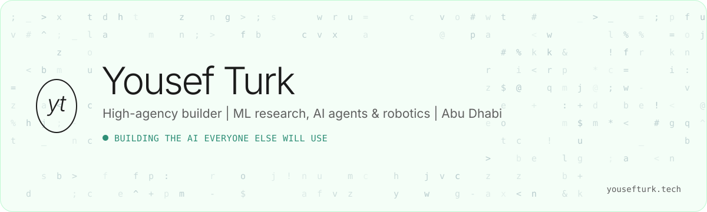

  <a href="https://yousefturk.tech">
    <picture>
      <source media="(prefers-color-scheme: dark)" srcset="assets/banner-dark.svg" />
      
    </picture>
  </a>

  
  
  
  
  

 

I'm 16, in Grade 12 at Liwa International School in Abu Dhabi, and I learn by building.
I found n8n at 13, opened Hugging Face for the first time and thought I'd found a secret nobody knew about.
I've been building ever since: research papers, AI agents, robots, and a lot of 48-hour hackathons.

What I care about most is **taste**. AI spends its time centering divs and following ratios.
I want models that can tell when something is actually good, and I want to build the company that makes that real.

 

## Scoreboard

| Result | Where | When |
| :--- | :--- | :--- |
| **1st place, Champion Award** | Qoder AI Hackathon, Alibaba Cloud × ZAKA at Ai Everything Abu Dhabi | Oct 2026 |
| **Top 40 globally** | Global Research Challenge 2026, first-author paper | 2026 |
| **1st place**, against university teams | ADU Engineering Hackathon, Abu Dhabi University | May 2026 |
| **Best Design** | Fish Tank by Cognition × Hub71, judged by OpenAI and Palantir | Sep 2026 |
| **4th place** | The Last Dance, Socia × Replit at 42 Abu Dhabi | Jul 2026 |
| **6th place** | eVoost × Cursor Abu Dhabi AI PropTech Challenge | Jun 2026 |

 

## Research

**[Steering cellular attractor trajectories](https://github.com/youseftrk/cell-steering-grc)**
If you edit one gene and then another, the second edit lands on a cell the first one already moved.
I built a VAE, a neural SDE and a PPO policy that plan the order, with a GPU simulator that runs 4,000+ trajectories in seconds on Perturb-seq data.
First author. Top 40 at the Global Research Challenge 2026.

**[How much does the page move?](https://yousefturk.tech/lab/reflow-is-low-dimensional)**
My answer to Taste Labs' Request for Research. I tracked 3,056 boxes across 65 window widths.
A one-line CSS rule beat my first model, then a boosting model beat the rule: 7.3px median error.

 

## Things I've built

<table>
  <tr>
    <td width="50%" valign="top">
      <a href="https://github.com/bilal-feroz/qoder-hackathon"><strong>UnderGrid</strong></a> 
      1st place · Qoder AI Hackathon  
      A 3D digital twin of Abu Dhabi's underground pipes. AI agents connect weak sensor signals, predict which pipe fails and when, and hand crews a repair plan before the street breaks.
    </td>
    <td width="50%" valign="top">
      <a href="https://github.com/youseftrk/qalaa"><strong>Qalaa</strong></a> 
      Best Design · Fish Tank by Cognition × Hub71  
      A permission layer that grants and revokes what AI agents can do inside government and enterprise systems. Pitched to judges from OpenAI and Palantir.
    </td>
  </tr>
  <tr>
    <td width="50%" valign="top">
      <a href="https://github.com/youseftrk/open-labs"><strong>Open Labs</strong></a> 
      Tauri 2 · React · TypeScript  
      A terminal for robot people. Sim, train and deploy in one spatial window.
    </td>
    <td width="50%" valign="top">
      <a href="https://github.com/youseftrk/open-real2sim-capture"><strong>Open Real2Sim</strong></a> 
      Python · early draft  
      Film a room with a phone or robot and turn it into a simulation. Synchronized RGB, depth, IMU and LiDAR capture, then
      <a href="https://github.com/youseftrk/open-real2sim-reconstruct">reconstruct</a> and
      <a href="https://github.com/youseftrk/open-physical-sim">simulate</a>.
    </td>
  </tr>
</table>

 

## Kaggle

| Competition | Notebook | Result |
| :--- | :--- | :--- |
| Pokémon TCG AI Battle | [deck miner](https://www.kaggle.com/code/yousefturk/ptcg-mine-meta) · [self-play](https://www.kaggle.com/code/yousefturk/ptcg-selfplay) | ladder 708, top 31% of 6,807 |
| NVIDIA Nemotron Reasoning | [PGPS fine-tune](https://www.kaggle.com/code/yousefturk/nemotron-pgps-fine-tune) | private 0.720 |
| AI Mathematical Olympiad 3 | [gpt-oss on local vLLM](https://www.kaggle.com/code/yousefturk/aimo-3-gpt-oss-vllm-solver) | private 38.5 |
| F1 Pit Stops | [three-tree ensemble](https://www.kaggle.com/code/yousefturk/p1-f1-pitstop-ensemble-v1-0) | private AUC 0.950 |
| ROGII Wellbore Geology | [LightGBM baseline](https://www.kaggle.com/code/yousefturk/rogii-lightgbm-baseline) | RMSE 13.880 |

 

## Right now

- Competing in the **Lexsi AI Safety & Alignment Hackathon** (Lexsi Labs × Cohere Labs × Hugging Face), Nov 2026
- Working on the **BrainTech** challenge, brain-computer interfaces, at the New York Academy of Sciences' Junior Academy
- Launching my school's **first AI Fair**, and leading robot design as robotics team vice president
- Most interested in **recursive self-improvement in core models**, not agents wrapped around a frozen one

 

## Stack

`Python` `PyTorch` `scikit-learn` `LightGBM` `Hugging Face` `vLLM` `LoRA` `LangGraph` `reinforcement learning` `MuJoCo` `Isaac Sim` `TypeScript` `React` `Next.js` `Tauri`

 

  
    <a href="https://yousefturk.tech">yousefturk.tech</a>
    &nbsp;·&nbsp;
    <a href="https://yousefturk.tech/lab">Lab</a>
    &nbsp;·&nbsp;
    <a href="https://yousefturk.tech/resume">Resume</a>
  

